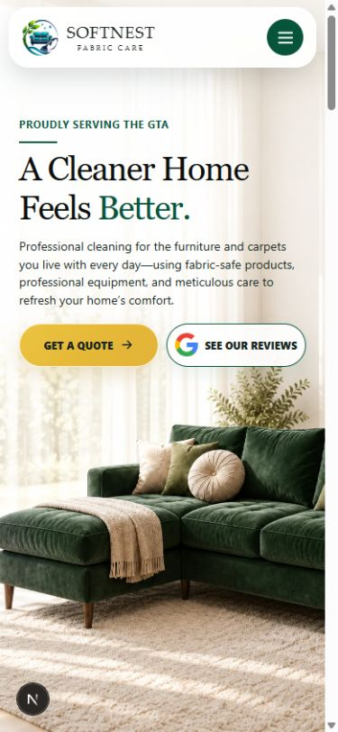
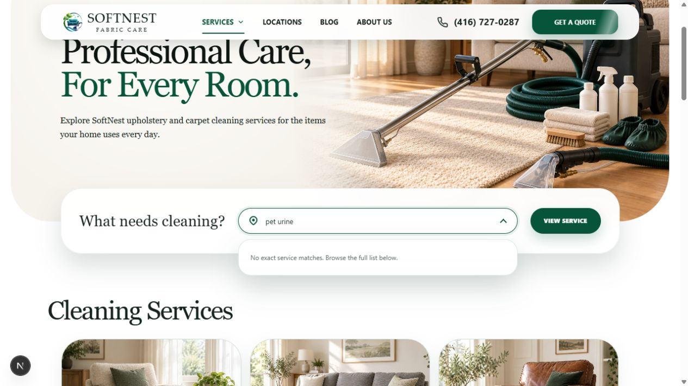
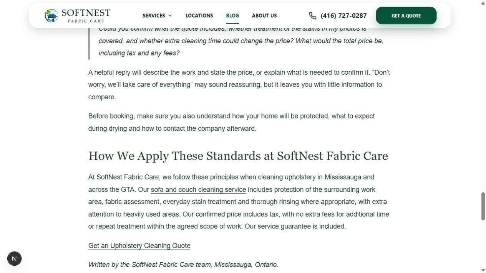
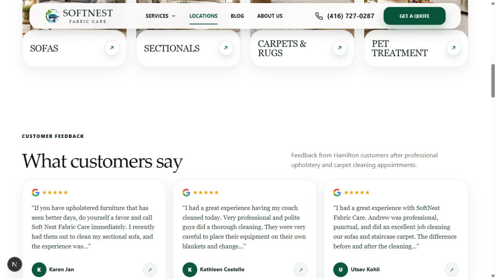
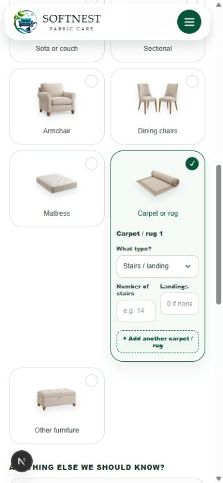
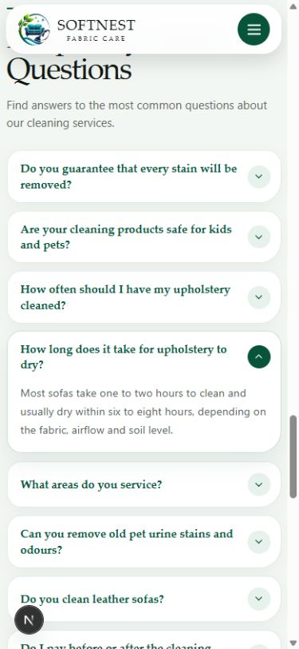

# SoftNest: the journey from a worried homeowner to a confident enquiry

**UX, customer confidence, marketing and content discovery audit · 8 October 2026**

Prepared for SoftNest Fabric Care, a family-run upholstery and carpet cleaning business serving Mississauga, the GTA and the additional cities listed on its website.

## The judgement

SoftNest already looks considered, calm and credible. The visual identity suits a service that enters people's homes and handles furniture they care about. Its explanations of fabric assessment, stain limitations and drying are more useful than another loud promise to make everything look new.

The main weakness is the distance between that attractive presentation and a confident buying decision. A visitor can learn that SoftNest is careful, but must work harder to establish a realistic budget, understand the guarantee, see who will arrive, and complete an enquiry with photos. Several of the best reasons to choose the business are present somewhere on the site, but do not appear where the customer needs them.

**The first investment should be a clearer decision and enquiry journey.** Keep the brand, the honest treatment advice and the genuine work. Make the offer easier to understand and the next step easier to take. More city pages, more generic articles or a wholesale visual redesign would come after these improvements.

This is an expert review of observed experiences. It identifies credible sources of hesitation; it does not claim measured conversion losses, customer motives or search-ranking penalties.

### The eight changes to put first

| Order | Change | Why it matters for SoftNest | Finding |
| --- | --- | --- | --- |
| 1 | Keep photo sharing within one coherent enquiry | Customers currently submit a form, then use Instagram or Facebook and identify themselves again | F01 |
| 2 | Give selected-item questions the full mobile width | The quote's stair and carpet details become cramped inside half-width cards | F02 |
| 3 | Carry the selected service and city into the quote | Customers arriving from a sofa or Toronto page have to repeat context | F03 |
| 4 | Explain the quote, reply channel and realistic response window | “Get my quote” and “soon” leave the next step uncertain | F04, F28 |
| 5 | Surface the existing tax-inclusive, agreed-scope pricing promise | A valuable business distinction is buried near the end of a long article | F05 |
| 6 | Correct or substantiate city-specific review attribution | The same reviews appear under different city-specific customer headings | F07 |
| 7 | Explain what the satisfaction guarantee actually provides | A prominent badge has no equally prominent practical remedy | F06 |
| 8 | Put a relevant quote action and decision summary near service-page titles | Search visitors land on a description, with their next step farther away | F08 |

**Priority meanings:** P1 = address first because it affects an enquiry or a central trust claim; P2 = improve the quality of choosing and exploring; P3 = useful polish after the main journey. These are review priorities, not numerical estimates of lost revenue.

## Scope and evidence

The primary review used the current project running locally. The published website, [softnestcare.ca](https://softnestcare.ca/), was also inspected as a baseline. The report distinguishes them where their experiences differ.

Coverage included the homepage; service and location directories; all **10 service pages**; all **9 city pages**; About; the journal directory and all **11 articles**; individual and business quote branches; selected validation and selection states; privacy and terms; and the thank-you page as a directly opened preview. Desktop, a mobile viewport override of 390 × 844, and a narrower 320 × 740 article view were inspected. These viewport checks are not physical-device testing.

**Important version difference:** the current quote already asks for a service city or postal code. The inspected published quote did not. The current photo instructions also explain how to match photos to an enquiry more clearly. The remaining criticism concerns the split journey and lost page context, not a missing city field in the current project.

Screenshots are numbered evidence references, such as **E51**. The accompanying [visual report](report.html) contains the findings and the complete screenshot appendix, grouped by journey step. The [evidence index](evidence-index.md) records the observed state, source and relevant step for each image. Local browser development controls visible in some images are outside this UX assessment.

### The complete journey at a glance

| Step | Customer task | General health | Main conclusion |
| --- | --- | --- | --- |
| 1 | Understand SoftNest on arrival | Good foundation; mixed decision clarity | Warm and credible, with practical distinctions too quiet |
| 2 | Find the right service | Needs attention | Customer problem wording and overlapping categories create avoidable work |
| 3 | Decide whether a service is right | Mixed | Careful explanations; price, proof and action need to arrive earlier |
| 4 | Judge results and trust | Mixed; attribution needs attention | Genuine work is valuable; shared city review labels need verification |
| 5 | Check service coverage | Generally good | Helpful neighbourhood matching; city context is lost at enquiry |
| 6 | Meet the business | Underdeveloped | Family-run positioning needs real people and a more useful About page |
| 7 | Request an individual quote | Needs attention | Flexible item choices, but fragmented photos and difficult mobile detail entry |
| 8 | Request business cleaning | Needs attention | A business form exists, but the journey to it is weak |
| 9 | Learn through the journal | Good content; mixed onward journey | Relevant advice needs faster answers and more specific next steps |
| 10 | Understand confirmation and follow-up | Needs attention; content preview only | “Soon” does not establish a clear expectation |
| 11 | Use the experience on mobile or by keyboard | Mixed | Several good responsive choices, plus a confirmed comparison-control problem |
| 12 | Find contact and service reassurance | Mixed | Contact and policies exist; useful everyday reassurance is dispersed |

## What the experience needs to accomplish

For SoftNest, “make people explore” should mean helping them find the next useful answer. Longer browsing is not automatically a better result. Someone with a stained sofa should be able to establish fit, trust the proposed assessment and request help without touring unrelated services.

| Visitor situation | What they are really trying to resolve | Best next content or action |
| --- | --- | --- |
| Pet accident or persistent smell | “Can you help, and have I made it worse with products?” | Realistic treatment limits, relevant result, photo-based assessment |
| Comparing sofa cleaners | “What will I pay, what is included, and will the price change?” | Example scope, agreed-price reassurance, relevant reviews, clear quote |
| Condo resident | “Can you work around elevators, parking and drying in my unit?” | Access guidance, what to tell the team, local enquiry |
| Several items around the home | “Can one visit cover my sectional, chairs and stairs?” | Simple multi-item request and an understandable combined scope |
| Owner of delicate or valuable furniture | “Will you recognise the fabric and avoid damage?” | Genuine assessment process, care-label request, named expertise, honest limits |
| Office or property contact | “Can you plan this around operations and give me a usable proposal?” | Commercial scope, frequency, email contact and business-selected enquiry |
| Visitor doing early research | “Should I attempt this myself or seek help?” | Immediate practical answer, clear stop conditions, relevant service |

The site's strongest potential position is **careful local cleaning with a clearly agreed scope and realistic expectations**. That position is supported by existing copy and customer comments. Confirm it with the owners, then repeat it consistently at decisions that matter.

## Step 1 — First impression and homepage

**Health: good visual foundation; mixed buying clarity. Evidence: E01, E03–E05, E45, E76.**

### F09 · State the service and location as clearly as the feeling · P2

**Observed:** “A Cleaner Home Feels Better” leads the page. Furniture/carpet cleaning and GTA coverage appear in supporting content. The combination is understandable, but the emotional headline carries more weight than the practical service statement.

**Customer consequence:** a visitor arriving quickly from search or a shared link must assemble the basic offer before comparing it with other cleaners.

**Recommendation:** keep the warm headline if it is important to the brand, but place an unmistakable line such as “Sofa, upholstery and carpet cleaning in Mississauga and across our GTA service area” directly with it. Follow with one verified distinction, such as an agreed scope and tax-inclusive confirmed price. Do not replace the whole opening with a list of keywords.

**Done when:** a new visitor can say what SoftNest cleans, where it works and what to do next after a brief look at the opening screen.

### F10 · Bring practical confidence into the opening, especially on mobile · P2

**Observed:** desktop shows benefit badges and a quote action; the mobile opening retains the quote but omits those benefit badges. The review section sits farther down. Several opening claims are broad, while the practical pricing promise is much deeper elsewhere.

**Recommendation:** use one compact, genuinely useful reassurance near the mobile quote action, for example careful fabric assessment and a price confirmed before work. Put a short review or result nearby. Keep the attractive room imagery, but let real work and practical information compete successfully for space.

**Done when:** the first mobile screen provides enough confidence to take the next step without requiring the visitor to open the menu or scroll through multiple decorative sections.

### F11 · Offer useful routes through the homepage · P2

**Observed:** the main service cards feature Sofas, Pet Treatment, Sectionals, and Carpets & Rugs. The remaining services are available through navigation and the footer. The hero review link leaves for Google; the “See How We Clean” preview leads to an Instagram profile.

**Recommendation:** retain four featured services, add a nearby “View all cleaning services” link, and create a clear secondary route to on-page results. Make the video destination explicit, or link to the actual relevant video if available. Put social following after the customer's immediate decision rather than giving it equal emphasis around proof.

**Done when:** a dining-chair or mattress customer can find their service easily, and someone choosing “See how we clean” knows whether they are about to open Instagram.

## Step 2 — Finding a service

**Health: needs attention. Evidence: E06, E07, E12, E25–E26, E40–E41.**

### F12 · Match the customer's problem, not just a service name · P1

**Observed:** typing **“pet urine”** into the service directory produces “No exact service matches,” despite a Pet Stain & Odour Treatment service. The same wording finds the relevant journal article. This was checked on the published site and the current project.

**Customer consequence:** a particularly motivated customer may infer that the business cannot help, or must browse the entire directory to disprove the message.

**Recommendation:** recognise common problem language and show the relevant service first. For this tested example, show Pet Stain & Odour Treatment and a short explanation that assessment depends on depth and fabric. If no match exists, offer “Ask us about this item or problem” with the visitor's wording retained. Other candidate phrases should be tested with real customer messages rather than assumed to fail.

**Done when:** “pet urine” clearly leads to the treatment service, with a useful fallback that does not discard the enquiry.

### F13 · Explain overlapping service categories · P2

**Observed:** Upholstery, Sofas, Sectionals and Armchairs are presented as adjacent short labels. The broader upholstery and sectional/furniture descriptions overlap with specific item pages. Searching “sofa” also exposes broader and material-related choices.

**Recommendation:** make the directory primarily item-led: sofa/couch, sectional, chairs/recliners, dining chairs, mattress, carpet/rug, stairs/hallways. Add one-line fit descriptions. Explain Upholstery as the umbrella or “other upholstered furniture” route. Treat leather as a material distinction and pet stains as a concern that can apply to several items.

This does not require removing existing useful pages. It requires making their relationship understandable. “Not sure? Send us your item” is a valuable safety net and already exists; retain it.

**Done when:** an ordinary visitor can choose confidently without knowing cleaning-industry terminology.

## Step 3 — Evaluating a service

**Health: mixed. Evidence: E08–E10, E13, E33–E41, E52, E75.**

### F08 · Give service landing pages an immediate next step · P1

**Observed:** the sofa page opens with a substantial image and description. A contextual quote action is absent from that opening. Desktop has the global header quote; mobile has logo and menu, with no equivalent immediate service action.

**Recommendation:** place “Request a sofa cleaning quote” beside the opening explanation, with a brief scope summary and one relevant piece of proof. Keep a call alternative where it is useful. Repeat the quote after the meaningful decision sections, not after every paragraph.

**Done when:** a visitor arriving directly at any service page can act from the opening, while a visitor who needs details can see what to read next.

### F05 · Make the strongest pricing reassurance easy to find · P1

**Observed:** service FAQs explain price factors but provide no concrete budget examples. The pricing article teaches comparison without giving figures. A different article, “How to Choose an Upholstery Cleaning Company,” states near its end that the confirmed price includes tax and that additional time or repeat treatment within the agreed scope does not incur extra fees. It also lists work-area protection, assessment, everyday stain treatment and appropriate rinsing.

**Customer consequence:** price-conscious visitors can miss a strong reason to prefer SoftNest. A review mentioning two sofas for $168, or a sectional for $229, can become the only numerical anchor they encounter, although those comments do not establish today's price for their job.

**Recommendation:** confirm this existing website promise with the owners and bring it into the service decision summary and quote introduction. Add a few approved example jobs or realistic ranges if the business can stand behind them. Explain inclusions, tax, minimum charges and any access/travel conditions that actually apply. If ranges cannot be published, clearly explain what is needed for a firm quote and when it will arrive. Avoid an attractive “from” figure that rarely represents a bookable job.

**Done when:** visitors understand how price is established and what prevents surprises. Historical review prices are clearly contextual, not presented as current offers.

### F14 · Convert long descriptions into an easy scope decision · P2

**Observed:** all ten service pages include useful explanations and realistic limits. The language often qualifies what cleaning “can include,” while another article makes more definite inclusion claims. Important assessment and drying details are scattered through prose.

**Recommendation:** introduce a compact decision panel: suitable items; standard agreed work; concerns requiring assessment; what cleaning cannot repair; approximate drying guidance with conditions; and how to get a confirmed price. Reconcile “can include” with the actual standard scope. Keep the detailed explanation below for cautious readers.

**Done when:** a customer can compare services without reading every paragraph, and every inclusion promised in an article matches the service description and quote conversation.

### F15 · Pair each service with the most relevant proof · P2

**Observed:** several service pages have captioned real-work comparisons. The pet service lacks an equivalent result in its observed main content, even though the sofa page includes a pet-stain example. Leather, armchair, stairs and general upholstery also have less specific proof in the reviewed content.

**Recommendation:** prioritise pet treatment, sofas/sectionals and carpets with genuine examples that explain the original concern and the achieved result. Reuse a job where it is truly relevant, with accurate context. Add leather or delicate-fabric evidence when the team has permission and a suitable real job. Do not fill gaps with synthetic before-and-after images.

**Done when:** a customer sees evidence for their concern and understands the limits of that example.

### Service-by-service implications

| Service reviewed | Preserve | Most useful improvement |
| --- | --- | --- |
| Sofa & Couch | Specific assessment, realistic stain limits, captioned result | Earlier quote, agreed scope and pricing reassurance |
| Sectional & Furniture | Shape/size relevance and real results | Explain its boundary with sofas, recliners and other furniture |
| Carpet & Area Rug | Distinguishes carpet/rug needs, useful result | Make stairs and commercial needs easier to route |
| Pet Stain & Odour | Honest discussion of deep contamination | Problem-led search, relevant real case and photo assessment |
| Leather Upholstery | Material-specific caution | Clearly route leather material in the quote; add genuine proof |
| Mattress | Item-specific explanation and real result | Clear scope and drying/use guidance near the action |
| Dining Chairs | Familiar item category and result | Easy quantity entry and any genuine combined-visit guidance |
| Armchair & Recliner | Familiar items and care explanation | Distinguish from broader furniture service and show relevant job |
| Stairs & Hallways | Dedicated service page | A visible stair route in the quote, with full-width detail questions |
| Upholstery | Useful broad category | Explain when to use it instead of a specific item page |

## Step 4 — Proof, reviews and promises

**Health: mixed; location attribution needs attention. Evidence: E03–E04, E21–E23, E43, E48, E66–E67, E76.**

### F07 · Make review location claims accurate · P1

**Observed:** the same three names and review text—Karen Jan, Kathleen Costello and Utsav Kohli—appear under “Feedback from [city] customers” on Toronto and the seven reviewed non-Mississauga city pages. Mississauga uses a different set.

**Customer consequence:** a reader comparing cities can notice the repetition and question the precision of the local proof.

**Recommendation:** check the original customer/job provenance. Use a shared “Feedback from GTA customers” heading unless a specific city is substantiated. Use genuinely city-specific reviews where they are available and permitted.

**Done when:** each location claim can be supported. This observation does **not** establish that the reviews are fabricated or that any named reviewer did not use the business.

### F06 · Give “Satisfaction Guaranteed” a practical meaning · P1

**Observed:** the homepage presents the badge prominently. The reviewed terms explain realistic result limitations and invite customers to contact SoftNest for a review of reasonable next steps, but do not give an equally concrete, prominent remedy or reporting window.

**Recommendation:** explain what customers should do, how promptly they should report a concern, how it is assessed and when follow-up treatment or a return visit is available. The owner must define the actual policy. Keep exclusions for permanent wear, dye loss and deep contamination understandable. A workmanship promise can coexist with honest stain limitations.

**Done when:** a customer can explain what the guarantee provides without interpreting a badge or assuming an unconditional refund. This is a clarity recommendation, not a legal assessment.

### F16 · Turn the gallery into understandable case evidence · P2

**Observed:** the homepage comparison gallery shows real work but lacks visible item/location/problem captions and prominent Before/After labels. Visitors must distinguish movement between jobs from movement within a comparison. Service-page captions provide better context.

**Recommendation:** label the sides, explain the comparison gesture, and add concise job context: item, verified city, concern, treatment scope and honest outcome. Offer a simple two-image view when comparison is difficult. Place a relevant enquiry action after the case, not social-follow controls in the main path.

**Done when:** a visitor can describe what changed, which item was cleaned and why the example is relevant. Maintain comparable lighting and angles; a result should not depend on flattering presentation.

### F17 · Make reviews informative and verifiable without forcing an exit · P2

**Observed:** a 5.0 Google rating appears without a visible count or review dates. Some review excerpts end in ellipses. Cards lead to the general Google listing rather than expanding their content on the page.

**Recommendation:** show a verified review count and a maintainable freshness cue. Keep source links, clearly labelled as opening Google. Where permission and source material allow, let visitors read the useful full comment on-site. Select reviews that address scope, final price, care in the home, drying and follow-up, rather than only general praise.

**Done when:** visitors can judge the depth and relevance of the proof and verify it if they choose. The rating and review authenticity were not independently audited.

### F18 · Explain family and product reassurance in practical terms · P2

**Observed:** badges say “Safe for Kids & Pets” and “Eco-Friendly Products.” The family-products FAQ instead gives a cautious explanation: fabric-appropriate products, directions followed, and drying/after-care before normal use.

**Recommendation:** bring that practical explanation closer to the promise. Explain when people and pets may use the cleaned furniture, what after-care is required, and how the team handles a disclosed concern. Use product-specific substantiation for environmental claims if the business wants to develop them. Avoid turning this into a long list of unsupported health benefits.

**Done when:** a parent understands the relevant precautions and use-after-cleaning guidance. No chemical safety or environmental certification assessment was performed.

## Step 5 — Coverage and city pages

**Health: generally good, with context and proof weaknesses. Evidence: E18–E23, E53–E54, E56, E59–E67.**

### F19 · Keep the useful local content; replace generic repetition with real local usefulness · P2

**Observed:** the city pages share substantial descriptions and process sections. They also contain distinct neighbourhood lists and FAQ questions, plus useful condo access, parking, elevator and drying guidance. This is more helpful than a city name substituted into every sentence.

**Recommendation:** preserve practical access guidance. Improve selected city pages with permissioned local job examples and accurate service arrangements. Prioritise the places that matter commercially once enquiry data is available. Explain extended service coverage consistently with the nine listed locations. Do not manufacture local offices, job histories or neighbourhood claims to make pages look different.

**Done when:** each city page answers a real local planning question and its proof is accurately labelled. The repeated content alone does not demonstrate a search penalty.

### F20 · Make coverage checking easier to start and interpret · P2

**Observed:** “Port Credit” resolves to Mississauga. An L5B search offers a manual availability check and carries L5B into the quote—both useful behaviours. On mobile, a large map precedes the location search, and the manual-check message is a small dark pill with a relatively quiet action.

**Recommendation:** put the search before the large illustration on mobile. Make the outcome an easily read message: “We can check service availability for L5B,” followed by a clear enquiry action. Explain that a manual check is uncertainty to resolve, not a rejection. Keep the retained input.

**Done when:** a customer can distinguish a confirmed listed city, an unmatched entry and a location awaiting confirmation without interpreting map boundaries.

### City coverage reviewed

Mississauga, Toronto, Brampton, Oakville, Etobicoke, Burlington, Vaughan, Milton and Hamilton were each read. The seven additional pages were compared with Toronto to assess what changed. Their separate FAQ topics and neighbourhood lists are strengths. Every collapsed FAQ answer and every neighbourhood synonym was not tested. The review attribution issue applies to the eight non-Mississauga pages observed, not automatically to all other testimonials on the site.

## Step 6 — Who will come into the home?

**Health: underdeveloped. Evidence: E24 and the homepage review content in E01/E45 journey.**

### F21 · Make the family-run claim human and useful · P2

**Observed:** About is a short, text-only explanation of a family-run business and careful service. It does not introduce named people, show the actual team, develop a specific origin story or provide a direct closing enquiry action. Customer comments mention Andrii and his son, which is more tangible than the business's own introduction.

**Recommendation:** introduce the actual team with approved names, roles and a genuine photograph. Explain why they do the work this way, how they assess furniture and what the appointment feels like. Show real work-area protection and equipment handling. Add substantiated training or insurance information only if verified. Finish with a quote or call route.

**Done when:** a hesitant customer has a clearer idea of who may arrive and why that person is competent and considerate. Avoid stock portraits, invented biographies and vague claims of decades of experience.

## Step 7 — Individual quote journey

**Health: needs attention; several good foundations. Evidence: E11, E14–E16, E49–E51.**

The multi-item approach is appropriate for this business. Adding more than one sofa is supported, and “Not sure” options reduce the need to know furniture terminology. Preserve those capabilities. A blank submission moved focus to the name field; no real request was sent. This audit does not establish that validation or delivery is broken.

### F01 · Remove the separate social-media photo task · P1

**Observed:** customers are told to request a quote, then send full-item photos and stain close-ups through Instagram or Facebook using the same name and service city. The current instructions are clearer than the published baseline, but the process still crosses channels and requires manual matching. The individual form has no email field or preferred reply channel.

**Customer consequence:** someone can complete the form yet fail to send the photos, lack a social account, switch apps and lose context, or wonder whether the two messages were matched. A busy person may intend to finish later and forget. These are plausible failure points, not measured abandonment rates.

**Recommendation:** let photos accompany the same enquiry, ideally as an optional attachment with simple guidance and a visible preview. Keep a viable “send later” route. If direct attachments are not presently feasible, provide an operationally supported email or other business-approved alternative with a clear matching instruction. Do not claim SMS or WhatsApp is available without confirming it. Social messaging can remain optional.

**Done when:** a person without Instagram or Facebook can complete a usable enquiry, knows whether photos were received, and understands whether further information is still needed.

### F02 · Expand item questions outside narrow mobile cards · P1

**Observed:** selected carpet/rug details expand inside one half-width item card. Stair and landing fields are especially narrow; labels and the add-another control wrap tightly. An adjacent unselected card leaves considerable unused space. E50 and E51 show the problem.

**Recommendation:** keep the compact initial item choices, then give the selected item's questions the full content width below them, or stack the selected detail sections. Provide a clear item heading and an easy way to add another. Preserve independent details for multiple items.

**Done when:** a mobile customer can enter stair counts, rug dimensions and sofa details comfortably without compressed labels or excessive sideways scanning.

### F03 · Remember the service and location already chosen · P1

**Observed:** the sofa service quote link leads to a generic quote without a selected sofa. Toronto's hero quote opens with the city field blank. By contrast, the unmatched L5B location route does retain its entered location.

**Recommendation:** use the retained-location behaviour as the model. Open a sofa quote with Sofa selected, and a Toronto enquiry with Toronto visible in the editable location field. Preserve the relevant concern from a pet-treatment route as well. Do not silently assume a full address or prevent customers changing the choice.

**Done when:** a customer continues the same task instead of starting the description again.

### F04 · Say what a quote request actually does · P1

**Observed:** the action says “Get my quote.” The form describes follow-up, but no specific reply window, reply channel or visible commitment/no-obligation explanation accompanies the decision. Free photo estimates are mentioned elsewhere in city content, rather than consistently at the form.

**Recommendation:** explain that a person reviews the details and confirms the scope and price. Use “Request my quote,” or “Request my free quote” if the owner confirms that policy. State a staffed response window that can actually be met, with out-of-hours wording where needed. Let the customer choose a supported reply channel and explain that requesting a quote does not book a visit, if that is the actual process.

**Done when:** before submitting, the visitor knows whether they will see an immediate price, receive a call or email, or need to provide more details.

### F22 · Ask about material and concern without requiring the right category guess · P2

**Observed:** the first quote choices are seven item groups. Stairs are nested under Carpet or rug, then a type choice. Leather and pet treatment are service concepts elsewhere, but are not explicit item choices here. Sofa follow-up asks about seats and type; the customer must use the notes to communicate additional concerns.

**Recommendation:** separate “What item?” from “What is it made of?” and “What concerns you?” Ask lightweight, optional questions with “Not sure.” Make stairs discoverable from the first selection or clearly label the carpet category to include them. A leather sofa is still a sofa; a pet accident is a concern, not a competing furniture category.

**Done when:** a customer with a leather couch, stained dining chairs or carpeted stairs can describe the job without guessing a category or typing the entire scope in notes.

## Step 8 — Business customers

**Health: needs attention. Evidence: E17, E31–E32, E34.**

### F23 · Connect commercial interest to a commercial conversation · P2

**Observed:** the Business quote branch asks for organisation, work email, frequency and location. The office-carpet article discusses commercial needs, but ends with household-oriented language and a generic quote route that defaults to Individual. The carpet service page is principally residential.

**Recommendation:** if commercial work is an active priority, give it a modest dedicated entry explaining suitable spaces, assessment, scheduling and recurring service. Lead the office article into a business-selected quote. Prefer an ordinary work-email photo/requirements exchange over asking an office manager to send job information through social media. Verify after-hours availability, invoicing, insurance and building requirements before presenting them as benefits.

**Done when:** an office contact can reach a relevant request without translating home-focused language or finding a hidden switch. Keep the homepage focused on households if they remain the core business; commercial work does not need equal prominence to have a coherent path.

## Step 9 — Journal and content-led discovery

**Health: good underlying advice; mixed answer speed and onward journey. Evidence: E25–E32, E57–E58, E68–E75.**

### F24 · Give urgent readers the useful answer sooner · P2

**Observed:** long titles, introductions and large imagery occupy substantial space. The mobile pet-urine guide's first screen establishes the subject but does not yet give the first practical steps. The company-selection article is long and has no visible contents navigation.

**Recommendation:** place a short, specific answer immediately after the introduction, then offer the detailed explanation. For an urgent spill, prioritise the first safe action, what to stop doing and when to ask for assessment. Use a short contents list on longer comparison articles. Keep valuable caution and explanation; shorten the distance to them.

**Done when:** a visitor in a hurry gains something useful before a large editorial image, and a comparison shopper can jump to pricing or guarantee questions.

### F25 · Complete the promise made by cost and drying topics · P2

**Observed:** the upholstery-price guide is sensible about comparison but does not supply a numerical budget. Its “five questions” framing helps qualify that, yet a price-first reader may still leave without an answer. The drying article uses general same-day guidance, while home/service content offers a more useful conditional 6–8 hour expectation.

**Recommendation:** make each article's scope explicit. Add approved cost examples and inclusions, or state clearly that it explains how quotes are determined. Align drying guidance around the actual fabrics and conditions the team sees; do not make 6–8 hours a universal promise. Include when to contact the cleaner if drying takes longer than expected.

**Done when:** the page gives the kind of answer its title invites, with meaningful caveats and a clear next step for exceptions.

### F26 · Guide the next click according to the reader's task · P2

**Observed:** relevant service links exist at article ends, which is useful. Many reviewed articles repeat the same stain-related “Keep reading” suggestions, including content whose audience may need different advice. The journal directory is searchable, but category labels are not useful browse filters.

**Recommendation:** organise the modest eleven-article library around needs: stains and pets; prices and choosing; drying and appointment care; routine maintenance; commercial cleaning. Recommend a small number of genuinely related next reads. Use a specific service or enquiry action after the section where help becomes relevant, rather than relying only on a generic “extra care” ending.

**Done when:** someone reading about office carpet is offered business help, and someone choosing a cleaner finds price, proof and guarantee information next.

### F27 · Show the real expertise behind the advice · P2

**Observed:** bylines primarily identify SoftNest Fabric Care; the long comparison article identifies the team at its end. There is no visible named author/reviewer introduction establishing who contributed the practical experience. Several pieces discuss careful technique, but the people behind it remain abstract.

**Recommendation:** use a real technician's name and a short, accurate role where they have genuinely authored or reviewed the advice. Include permissioned photographs or concise examples from the team's work, especially when explaining residue, pet contamination or protecting floors. Maintain dates when advice actually changes. Do not add credentials or “expert reviewed” labels without a real process.

**Done when:** readers can connect the advice with a real person and relevant experience.

### Article coverage and editorial priorities

| Article reviewed, abbreviated for scanning | Strongest value | Next improvement |
| --- | --- | --- |
| Upholstery cleaning prices in Toronto: five questions | Teaches scope and quote comparison | Approved budget examples and visible pricing promise |
| Pet urine on a couch | High-intent problem and realistic contamination explanation | First actions sooner; pet-specific assessment route |
| Couch drying after cleaning | Addresses an important day-of concern | Consistent conditional time range and exception guidance |
| Office carpet cleaning frequency | Useful commercial planning | Business route and business-oriented related advice |
| How to choose an upholstery cleaning company | Detailed, fair comparison; specific SoftNest standards | Contents list; move its valuable SoftNest promise into buying pages |
| Signs a sofa needs cleaning | Helps early-stage recognition | Align stated inclusions with actual service scope |
| Vacuuming and professional carpet cleaning | Explains maintenance versus deeper cleaning | Relevant carpet enquiry and maintenance next reads |
| Dirty sofa armrests | Specific everyday problem | Real close-up case and contextual sofa action |
| Remove a couch stain without making it worse | Conservative practical sequence and stop conditions | Faster first-answer access and clear photo help |
| Why a couch stain returns | Useful distinction between wicking, residue and damage | Relevant assessed case and follow-up route |
| What cleaning solution to use | Avoids one-product-fits-all advice | Short initial checklist and named practical reviewer |

### SEO through a better customer experience

This review concerns content usefulness and discovery, not site mechanics. The most credible search opportunity is to make existing pages satisfy their visitors more completely.

- **Service intent:** make the item, service area, scope, proof and enquiry obvious on the landing page. Use natural customer language such as couch, sofa, pet urine and stairs where it genuinely describes the service.
- **Price intent:** resolve budget uncertainty with honest examples and inclusions rather than adding more words around a price question.
- **Local intent:** build on real jobs and genuine access information. Repeating a city name cannot substitute for local usefulness.
- **Problem intent:** answer the immediate question, explain limits, then link to the service that can assess it.
- **Trust:** introduce the real business and keep names, service coverage and contact details consistent with the public business profile.

Google's guidance supports useful content grounded in real experience and written for people. That is a reason to improve answer completeness and authorship, not a promise of higher rankings. [Google: creating helpful, reliable, people-first content](https://developers.google.com/search/docs/fundamentals/creating-helpful-content).

Google also warns about pages created mainly to funnel similar searches onward. The shared city structure observed here is **not** evidence of a violation. It is a reason to prioritise genuine local value before expanding city-page volume. [Google: spam policies](https://developers.google.com/search/docs/essentials/spam-policies).

Clear public business details help people identify the correct business. Verify the actual business profile and align its customer-facing information with the website as part of ongoing content maintenance. No profile verification or ranking audit was performed here. [Google: establish your business details](https://developers.google.com/search/docs/appearance/establish-business-details).

## Step 10 — Confirmation and follow-up

**Health: needs attention; confirmation content only. Evidence: E44.**

### F28 · Give the customer a concrete next expectation · P1

**Observed:** the directly opened thank-you screen says the request was received and the team will be in touch “soon.” It offers social photo sharing and a phone option. It does not establish a specific response window or show a customer-specific request summary in the preview.

**Recommendation:** tell customers the supported reply channel and a realistic staffed window, including out-of-hours expectations. Show the submitted scope and photo status when available. State clearly whether a booking has been made. If more information is needed, offer one obvious completion action. Keep the phone option for time-sensitive questions without implying emergency availability.

**Done when:** a customer knows what has been received, what is outstanding, when to expect a reply and what to do if it does not arrive.

**Evidence limit:** the page was opened directly. No lead was submitted, and successful delivery, personalised confirmation, failed submission and subsequent communications were not tested.

## Step 11 — Mobile and accessibility observations

**Health: mixed. Evidence: E45–E58, plus E04/E48.**

### F29 · Separate comparison controls from gallery navigation for keyboard users · P1

**Observed:** pressing ArrowRight while focused on the sofa before/after comparison left its value at 50 and advanced the gallery from item 1 to item 2. This was reproduced in the current project. Pointer dragging a sectional comparison did change the comparison, so the issue is specific to the observed keyboard interaction.

**Recommendation:** a focused comparison should respond to its expected adjustment keys without changing the job. Give gallery navigation separate, clearly named controls. Preserve a simpler way to view both images.

**Done when:** a keyboard user can inspect the before and after views, then independently choose another job, with a visible focus indication.

### F30 · Keep answers next to questions and tasks ahead of decoration · P2

**Observed:** desktop homepage FAQ answers appear across the layout, below a large sofa image, with an initially empty answer area. Mobile uses inline answers, which is easier to follow. The mobile location directory gives a large map priority over search; service and journal directories also devote substantial opening space to imagery.

**Recommendation:** preserve the mobile inline FAQ and apply the same close question/answer relationship on desktop. Consider opening the most useful answer initially. Bring search and choice controls earlier on small screens. Order FAQs around buying blockers: quote/price, drying, treatment limits, access, preparation and guarantee.

**Done when:** a selected answer is easy to locate and a directory visitor reaches the relevant choice without unnecessary scrolling.

### F31 · Improve contact access and small-text comfort on mobile · P2

**Observed:** the mobile menu provides call and quote actions once opened. Service openings do not provide a direct action outside that menu. Some uppercase labels, muted supporting text and status messages are small. The tested 320-wide article did not show overall horizontal overflow in its observed state.

**Recommendation:** give service openings a direct action first. Then consider a compact call/quote bar after scrolling if it demonstrably helps; it must not obscure form fields or the keyboard. Enlarge important status text and secondary instructions. Check touch targeting, text enlargement, focus order and contrast across the completed journey.

**Done when:** a customer can call or enquire comfortably, and important instructions remain readable when text is enlarged.

These are observed usability and accessibility risks, not a certification or full accessibility assessment. Screen-reader interpretation, all keyboard paths, measured colour contrast, reduced-motion preferences, real-device zoom and motor-access needs require further testing. Do not label the site compliant from screenshots alone.

## Step 12 — Contact, policies and appointment reassurance

**Health: mixed. Evidence: E42–E43, E55, E75–E76.**

### F32 · Put everyday service reassurance where people look for it · P2

**Observed:** privacy and terms are accessible and readable. The privacy explanation says customer photos are not published without separate permission, which is useful reassurance. The footer Contact area provides email and GTA location information, but no phone or hours; the phone is elsewhere in the desktop header and mobile menu. Guarantee, pricing and preparation details are distributed across different pages.

**Recommendation:** add a plainly labelled phone, normal contact hours and reply expectations to the footer/contact area. Near photo sharing, state the actual privacy practice briefly. Create a concise “Before your visit” explanation covering accessible furniture, pets, parking/elevator information and drying, using the team's real requirements. Bring policy essentials into the relevant decision and link to the full text.

**Done when:** someone reaching the footer can contact the business and understand the practical next step without searching back through the site. A business-domain email could be a later polish choice; it is less urgent than making the existing contact path coherent.

## Suggested customer-facing wording

These are working recommendations, not approved promises. The owner should verify operational details before publication. Existing website statements are distinguished from new choices below; a statement observed in the current project has not necessarily been verified on the published website.

### Homepage opening

> **Careful sofa, upholstery and carpet cleaning across the GTA.**
>
> A cleaner home feels better. We assess your fabric and areas of concern, explain what improvement is realistic, and agree the cleaning scope before we start.
>
> **Request a cleaning quote** · **See our results**

The service-area line should reflect the business's exact coverage. The original emotional headline can remain if this practical line is equally easy to see.

### Pricing reassurance

> **A clear price for the work we agree.**
>
> Our confirmed quote includes tax. Extra time or repeat treatment within the agreed scope does not add extra fees. We explain the proposed work and any limitations before you decide.

This develops the promise already present in the company-selection article. Confirm that it is current and applies to the services where it will be shown. Explain any actual exclusions alongside it.

### Quote introduction

> **Tell us what needs cleaning.**
>
> Choose your items and share any stains, odours or access details. A SoftNest team member will review your request and confirm the proposed scope and price.
>
> **Request my quote**

Add a verified response window and reply channel here. Add “free” and “no obligation” only once the actual policy is confirmed. If photos become part of the form, describe them as helpful rather than making a perfect set of photos a prerequisite for starting a conversation.

### Guarantee explanation

Use a short owner-approved statement answering: **“What should I report, how soon, how will you assess it, and when is further work included?”** Keep stain-removal limitations beside it. No new refund, return-visit or response-time promise is proposed as a fact in this audit.

### Confirmation structure

> **Your quote request has been received.**
>
> We will review your items and contact you using your selected reply method. Your appointment is confirmed only after we agree the details with you.

Use the final sentence only if it describes the actual booking process. Follow with the real response window, a request summary, photo status and a clear fallback contact. Avoid leaving “soon” as the only expectation.

## Recommended page order

These are content priorities, not a requirement to rebuild every page.

| Surface | Recommended sequence |
| --- | --- |
| Homepage | Clear service/location + quote → short verified proof → what needs cleaning → relevant real results → agreed-scope/pricing reassurance → meet the team → useful FAQs → quote and contact |
| Service page | Item-specific offer + quote → suitable items and concerns → relevant result/review → standard agreed scope and limitations → price explanation → process, access and drying → related questions → contextual quote |
| City page | Confirm coverage + local quote → relevant services → practical access guidance → genuine local or accurately labelled regional proof → neighbourhood/availability help → local questions → quote with city retained |
| Individual quote | Clear expectations → item and location context already retained → comfortable item details → optional material/concerns and photos → contact/reply preference → summary and request action |
| Business journey | Commercial scope → scheduling/assessment expectations → relevant proof → organisation/contact/location/frequency → requirements/photos through a supported business channel → business confirmation |
| Article | Direct answer → practical sequence or comparison → examples and limits → relevant next service/help → task-specific related reading |

Avoid adding mandatory fields merely because information might be useful. Request what is needed to provide a helpful first reply; gather remaining details during assessment.

## Delivery plan and decisions

### First pass — remove enquiry friction and trust ambiguity

| Work package | Findings | Responsible business input | Acceptance |
| --- | --- | --- | --- |
| Coherent photo and reply journey | F01, F04, F28 | Which channels are staffed; response window; whether estimates are free | A non-social customer can request and complete a usable quote |
| Comfortable mobile item detail entry | F02, F22 | Minimum details genuinely needed for each item | Sofa, carpet and stairs tasks work comfortably at small widths |
| Retained context and service-page action | F03, F08 | Preferred enquiry action wording | Service/city visitors continue with their selections visible |
| Accurate reviews and clear guarantee | F06, F07 | Original review locations; actual remedy and reporting policy | Published location/guarantee claims can be explained and supported |
| Visible agreed-price reassurance | F05 | Confirm scope, tax, fee exceptions and examples | A visitor understands the pricing process before requesting help |
| Usable keyboard comparison | F29 | No special policy decision | Comparison adjustment and next-job navigation work independently |

### Second pass — make SoftNest easier to choose

Improve service categorisation and search; add real job stories; introduce the team; improve review context; tighten service scope summaries; bring location search and mobile actions forward; make contact and appointment guidance easy to find. Use actual customer enquiries to choose the most important vocabulary and questions.

### Third pass — strengthen exploration and content discovery

Improve article answers and next steps; organise the journal by customer need; connect commercial content to its form; build useful local evidence for priority cities. Expand content only after existing high-intent pages answer their questions well.

The sequence is more useful than a promised calendar without knowing staffing, photo workflow and content availability. A small first release can improve the quote journey before a larger proof-and-content refresh.

### Owner decisions needed before publishing promises

1. Is every enquiry/estimate free, and what exactly commits a customer to a booking?
2. Which reply and photo channels are reliably staffed? What reply window is realistic, including evenings and weekends?
3. Does the tax-inclusive, no-extra-time-fee promise apply to all services? What changes require a revised agreed scope?
4. What does satisfaction follow-up provide, and what reporting period is workable?
5. Which reviews can accurately be attributed to each city? Which may only be presented as regional feedback?
6. Which real team names/photos, job photos and client details are approved for publication?
7. What are the actual minimum charges, travel/access conditions and commercial scheduling capabilities, if any?

These are content and operating decisions, not permission requests to perform this audit.

## How to validate the changes with people

Run short sessions with people resembling actual customers, including someone who is unfamiliar with upholstery terminology, someone using a small phone, and someone who does not use Instagram or Facebook. Observe what they do before explaining the site. A small set of sessions provides directional insight, not a population-wide conversion estimate.

| Task | What a successful experience looks like |
| --- | --- |
| “Your dog had an accident on a sofa. Find out whether this business can help.” | Finds pet treatment using ordinary wording; understands limits; reaches relevant assessment |
| “Compare this cleaner with another for a three-seat sofa.” | Explains scope, price process, tax/fees, proof and guarantee without hunting through articles |
| “Request cleaning for two sofas and carpeted stairs from your phone.” | Adds the items comfortably, retains separate details, sees a clear summary |
| “You live in a Toronto condo. Ask about a quote.” | Recognises coverage, retains city, sees what access details matter |
| “Send enough information for a quote without a social-media account.” | Completes a supported route and knows whether photos are still needed |
| “Use the result comparison with a keyboard.” | Adjusts the before/after view without accidentally changing jobs |
| “You manage a small office and need recurring carpet cleaning.” | Finds commercial information, uses Business request, receives relevant expectations |

Ask afterwards: “What happens next?”, “What might change the price?”, “What does the guarantee mean?”, and “What information are you still missing?” Those answers reveal whether the changes improved confidence.

### Business outcomes to watch

Use a baseline before setting targets. Track the proportion of started enquiries that become usable requests; photo completion; how often the team must chase missing item/location information; qualified enquiries that become booked jobs; response time against the published promise; and the sources/services producing useful enquiries. Separate households from businesses and mobile from desktop when practical.

Do not optimise only for more form submissions. A useful enquiry that can become a well-scoped job is worth more than a larger pile of incomplete or mismatched requests. Avoid interpreting longer sessions or more page views as success when visitors may be confused.

## Evidence limits and review integrity

- This is a UX, messaging and content-discovery review. It contains no code, hosting, performance, security, structured-data or other technical audit.
- Observed interface states support the findings. Customer hesitation and commercial impact are expert interpretations to validate, not measured facts.
- No analytics, search performance reports, session recordings, interviews or competitor conversion data were available. No ranking, traffic or revenue effect is quantified.
- No real lead, phone call, email, social message, booking or payment was sent. The thank-you page was inspected directly; delivery and follow-up remain untested.
- All listed service, city and article bodies were reviewed. Not every collapsed FAQ, form combination, input edge case or search synonym was exercised.
- Google review origins, counts, job cities, product claims, qualifications and insurance were not independently authenticated. Verification is recommended where the site relies on those claims.
- Mobile observations use browser viewport overrides, not real-device or assistive-technology coverage. No complete accessibility or legal-compliance claim is made.
- Published and current project states differed. Evidence E01–E11 records the published baseline; E12 onward records the current project. Later screenshots include selected mobile and narrow views. E44 is a confirmation preview, not evidence of a delivered lead.

The practical standard for the next version is straightforward: **a visitor should be able to recognise their problem, see believable relevant evidence, understand the proposed service and price process, and request help without repeating themselves or needing a social account.**

## Screenshot appendix

Open the [visual report and complete screenshot appendix](report.html#evidence-gallery) for every accepted capture, arranged by the twelve journey steps. The [evidence index](evidence-index.md) provides individual file links and notes. The gap at E02 is intentional: an unusable loading capture was rejected.
